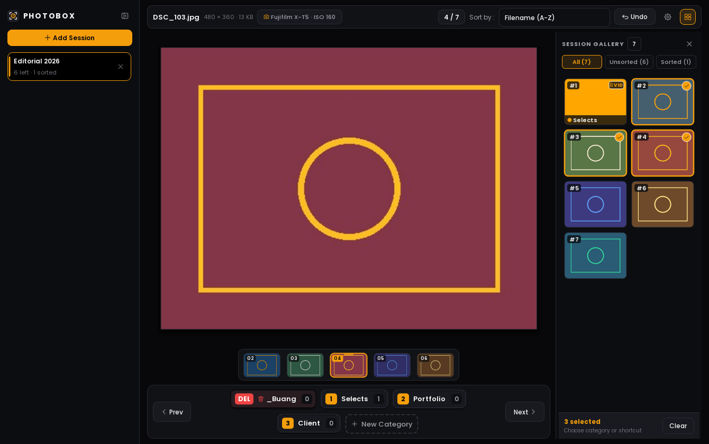
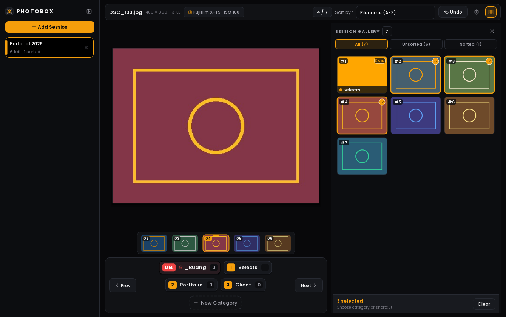
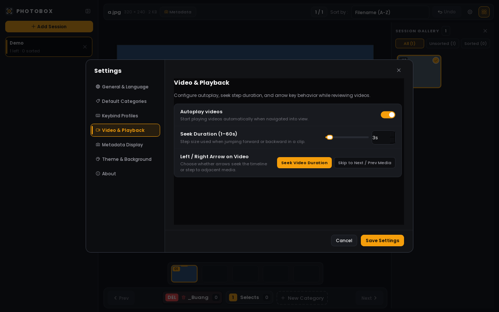
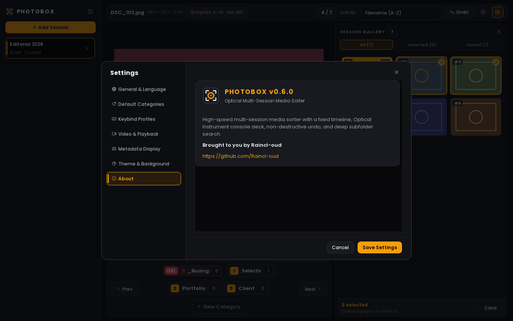

<div align="center">
  
  <h1>PhotoBox</h1>
  <p><strong>Optical Multi-Session Media Sorter</strong></p>
  <p>High-speed desktop photo &amp; video triage built with Python, PyQt6, Pillow, and FFmpeg — featuring zero-latency keyboard sorting, a resizable session gallery with bulk selection, EXIF lookup, and non-destructive batch undo.</p>

  <p>
    <a href="https://github.com/Raincl-oud/Photo-Box/releases"></a>
    <a href="https://github.com/Raincl-oud/Photo-Box/actions/workflows/ci.yml"></a>
    
    
    <a href="LICENSE"></a>
  </p>
</div>

---

## Screenshots

| Sorting Workspace & Right Session Gallery (`Shift+Click` Bulk Select) | Expanded Gallery (3+ Dynamic Columns) |
| :---: | :---: |
|  |  |

<details>
<summary>Refined Settings Overlay (7 Menus · Black &amp; White Themes)</summary>

<br />

| Video &amp; Playback Controls | About PhotoBox |
| :---: | :---: |
|  |  |

</details>

---

## Key Features

- **Fast Hardware-Friendly Media Viewport (`PhotoCanvas`):** C++ `QImageReader` EXIF-oriented pre-scaled decoding with background neighbor preloading, smooth wheel zoom-to-cursor, and integrated single-pass `QtMultimedia` video playback (`mp4`, `mov`, `mkv`, `avi`, `webm`, `m4v`) alongside photos (`jpg`, `jpeg`, `png`, `webp`, `bmp`, `gif`).
- **Multi-Session Timeline & Deep Search:** Track multiple folders independently in the left sidebar (`sessions.json`), enable optional recursive **Deep Search** when subfolders exist, and sort by **Filename (A–Z / Z–A)**, **Date Modified (Oldest / Newest)**, or **File Size (Largest / Smallest)**.
- **Resizable Right Session Gallery & Bulk Categorize (`Ctrl+G`):** Scrollable viewport-aware thumbnail grid with `[All]`, `[Unsorted]`, and `[Sorted]` filters, draggable left resize handle (`180px` up to window clamp) that dynamically reflows columns, plus `Shift+Click`, `Ctrl+Click`, and `Shift + Left/Right Arrow` multi-selection for bulk sorting & 1-step **Batch Undo** (`Ctrl+Z`).
- **3D Keycap Console Deck & Custom Profiles:** Pinned left-most `[DEL] _Buang` trash action, right-click category editing (Rename, Change Keybind, Change Color, Revert & Remove), and named 9-slot keybind profiles in Settings.
- **Viewfinder Metadata Lookup:** Inline EXIF/stream capsule in the top HUD bar, quick hover readout card, and centered full metadata modal with one-click **Copy All**.
- **Optical Instrument Themes & Localization:** Matte Carbon (**Black**) and Studio Daylight (**White**) palettes, optional custom window backdrop with `20–90%` scrim dimming, bundled `Poppins` typography, and live switching between **English** (`en`) and **Bahasa Indonesia** (`id`).

---

## Keyboard Shortcuts

| Shortcut | Action |
| :--- | :--- |
| `1` – `9` *(or custom keys)* | Move current item (or all selected gallery items) to category |
| `Del` *(customizable)* | Move current item (or selected items) to Trash (`_Buang`) |
| `Left` / `Right` | Previous / Next item on photos; Seek (or Skip) on videos |
| `Space` | Next item on photos; Play / Pause on videos |
| `Space + Left` / `Right` | Jump continuously between videos without releasing `Space` |
| `Shift + Left` / `Right` | Extend / shrink visible selection range when Right Gallery is open |
| `Backspace` | Step back to previous item (non-destructive) |
| `Ctrl + Z` | Undo last move or entire bulk-move batch |
| `Tab` | Collapse / expand Left Session Sidebar |
| `Ctrl + G` | Collapse / expand Right Session Gallery |
| `Esc` | Close active overlay or clear gallery multi-selection |

---

## Getting Started

### Download Pre-Built Executable
Download standalone `PhotoBox.exe` from the [GitHub Releases](https://github.com/Raincl-oud/Photo-Box/releases) page (built automatically on `v*` tags via GitHub Actions).

### Prerequisites
- **Python 3.10+** (tested on Python 3.13 / 3.14 on Windows 11)
- **FFmpeg & FFprobe** on `PATH` *(optional for still-image browsing; required for video filmstrip thumbnails, video stream metadata, and running the video unit tests)*

### Run from Source
```powershell
git clone https://github.com/Raincl-oud/Photo-Box.git
cd Photo-Box
python -m venv .venv
.\.venv\Scripts\Activate.ps1
pip install -r requirements.txt

python main.py
# or windowless launcher:
python PhotoBox.pyw
```

### Run Tests & Headless Self-Check
```powershell
$env:QT_QPA_PLATFORM = "offscreen"
python -m unittest discover -s tests -v
python main.py --self-check
```

### Build Standalone Windows Executable
```powershell
pip install pyinstaller
powershell -ExecutionPolicy Bypass -File .\build_exe.ps1
```
The self-contained executable outputs to `dist\PhotoBox.exe` with bundled `Poppins` fonts and `assets\icons\photobox.ico`.

---

## Project Structure

```text
Photo Sorting/
├── assets/
│   ├── fonts/               # Bundled Poppins font family (Regular..Bold)
│   └── icons/               # PhotoBox app & executable icons (.ico / .png)
├── core/
│   └── session_manager.py   # Session persistence, timeline state, EXIF/FFprobe, bulk move & undo
├── docs/
│   ├── images/              # README UI screenshots
│   └── superpowers/specs/   # Design specifications
├── tests/
│   ├── test_session_manager.py
│   └── test_ui.py
├── ui/
│   ├── filmstrip.py         # Centered 5-slot filmstrip tray & background thumbnail loader
│   ├── flow_layout.py       # Centered wrapping layout for category keycaps & setup chips
│   ├── gallery_sidebar.py   # Resizable right session gallery with range selection
│   ├── i18n.py              # English & Bahasa Indonesia localization
│   ├── icons.py             # Vector QPainter icons & Optical Aperture Box brand logo
│   ├── motion.py            # Cubic-bezier animators & stacked view transitions
│   ├── photo_canvas.py      # Media viewport, zoom/pan, video controls & Action HUD
│   ├── theme.py             # Matte Carbon & Studio Daylight palettes + QSS stylesheet
│   └── views.py             # Setup, Sorting, Complete views & 7-menu Settings overlay
├── .github/workflows/       # Windows CI test suite & tag-triggered .exe release build
├── build_exe.ps1            # PyInstaller single-file build script
├── main.py                  # Application entrypoint & MainWindow controller
├── PhotoBox.pyw             # Windowless Python launcher
├── CHANGELOG.md             # Release notes
├── VERSION.md               # Monotonic version ledger
└── LICENSE                  # MIT License
```

---

## License

Released under the [MIT License](LICENSE) © 2026 [Raincl-oud](https://github.com/Raincl-oud).
